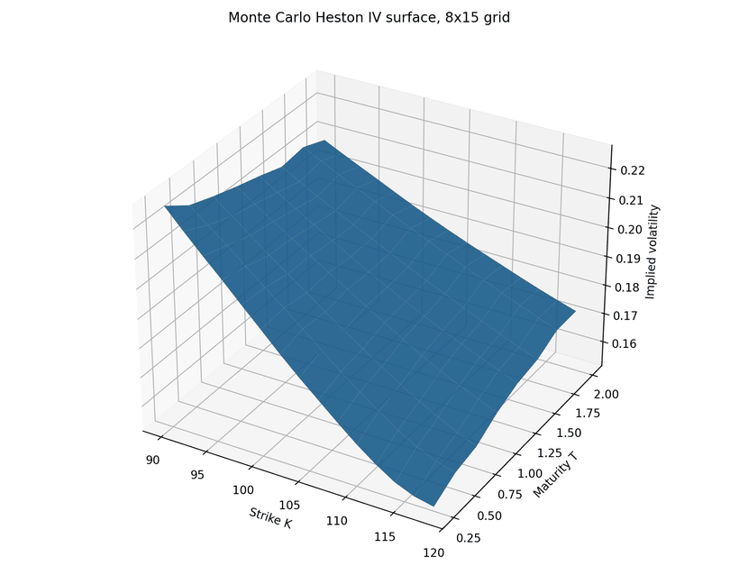

# Deep neural network surrogates for Heston implied-volatility surfaces

This undergraduate research project trains a neural network to approximate the implied-volatility (IV) surface of the Heston model. Generating a reference surface requires Monte Carlo pricing and IV inversion. Once trained, the network predicts all 120 IVs for a new Heston parameter set in one forward pass. The experiments measure prediction error, check call-price convexity and compare the runtime of the two methods.



*One Monte Carlo reference surface generated by `benchmark_mc.py`. Each grid point is the implied volatility of a simulated European call price.*

## Model and reference results

For each set of five Heston parameters (`v0`, `rho`, `kappa`, `theta`, `sigma_v`), the simulator prices calls at 8 maturities (0.25 to 2 years) and 15 strikes (90 to 118), with spot 100 and risk-free rate 2%. It uses 5,000 paths, 400 time steps and antithetic sampling. Inverting the Black–Scholes price at each of the 120 nodes gives the reference IV surface.

The v4.1 network encodes the five parameters and uses a shared decoder across strikes and maturities. At each node it predicts positive total implied variance $w(K,T)$, recovers IV as $\sqrt{w(K,T)/T}$, and uses the implied call prices to penalise violations of convexity across strikes during training.

The project manuscript reports the following results on **1,500 held-out synthetic Heston surfaces**. The split assigns whole surfaces to training, validation and testing (7,000 / 1,500 / 1,500, split seed 42).

| Measure | Reported value |
| --- | ---: |
| IV RMSE across all test nodes, in decimal volatility units | 0.006972 |
| IV MAE across all test nodes, in decimal volatility units | 0.004818 |
| Predicted call-price surfaces passing strike convexity at every tested node | 97.53% |

## Install

Clone the repository and create a virtual environment. Run the remaining commands from the repository root. The generated datasets and trained weights are not bundled with the source.

```sh
git clone https://github.com/Ericvsky/DNN-surrogates-for-Heston-MC-generating-IV-surface.git
cd DNN-surrogates-for-Heston-MC-generating-IV-surface
python -m venv .venv
```

Activate the environment with `source .venv/bin/activate` on macOS or Linux, or `.\.venv\Scripts\Activate.ps1` in Windows PowerShell. Install the four packages used by the Monte Carlo example.

```sh
python -m pip install numpy pandas scipy matplotlib
```

Add PyTorch and scikit-learn for DNN training and evaluation.

```sh
python -m pip install scikit-learn torch
```

## Generate the example surface

```sh
python benchmark_mc.py
```

Open `mc_benchmark_8x15_output/mc_iv_surface_3d_8x15.png` to see the reference surface. The same directory contains IV smiles by maturity, path and time-step convergence checks, and a comparison with a semi-analytical Heston reference price. This CPU example was run with Python 3.13.5, NumPy 2.1.3, pandas 2.2.3, SciPy 1.15.3 and Matplotlib 3.10.0. It recovered IVs at all 120 nodes with zero price repairs.

## Train and evaluate from a fresh clone

```sh
python build_heston_dataset.py
python check_heston_dataset.py
python train_heston_totalvar_priceconvex.py
python evaluate_heston_totalvar_priceconvex.py
```

1. **Generate labels.** The builder writes 10,000 accepted Heston surfaces to `heston_dataset_10000_8x15_output/`. The checker verifies the dataset dimensions and quality filters. The `clean_train_only.csv` filename suffix identifies the table with five inputs and 120 IV targets. It contains all three splits.
2. **Train the surrogate.** Training selects CUDA when available and otherwise runs on CPU. It writes the best validation checkpoint, split indices, loss history and pooled test metrics to `training_output_10000_8x15_totalvar_priceconvex_v4_1/`.
3. **Inspect the held-out predictions.** The CPU evaluator writes per-surface errors, price-shape checks and heatmaps to the `evaluation_10000_8x15_v4_1/` subdirectory of the training output. The heatmaps show Monte Carlo IV, predicted IV and absolute error for selected test cases.

To compare a run with the reported IV RMSE, use `test_rmse_iv` in `metrics_10000_8x15_totalvar_priceconvex_v4.1.txt` in the training output. The evaluator also reports `mean_surface_rmse_iv`, which computes one RMSE per surface and then averages them. Retraining can give different figures across numerical libraries or devices.

### Evaluate an existing checkpoint

If you already have a matching v4.1 checkpoint and dataset, place them at the following paths relative to the repository root.

```text
heston_dataset_10000_8x15_output/heston_dataset_10000_8x15_clean_train_only.csv
training_output_10000_8x15_totalvar_priceconvex_v4_1/heston_totalvar_priceconvex_10000_8x15_v4.1.pt
```

Keep the complete CSV in its original row order. The checkpoint stores the test rows as integer indices. Run `python evaluate_heston_totalvar_priceconvex.py` to regenerate the evaluation outputs without retraining.

### Additional experiments

| Command | Output |
| --- | --- |
| `python prepare_totalvar_price_dataset.py` | Exports the derived total-variance and Black–Scholes price labels to `derived_dataset_10000_8x15_v4_1/` for inspection. Training computes these labels internally. |
| `python benchmark_runtime_mc_and_totalvar_dnn.py` | After training, writes Monte Carlo and DNN timing results to `runtime_benchmark_10000_8x15_v4_1/`. DNN timings cover the forward pass on the selected device, with inputs already prepared and transferred to the device. Results are reported by batch size. |

The [simulation toolkit](heston_mc_benchmark_toolkit.py), [training script](train_heston_totalvar_priceconvex.py) and [evaluation script](evaluate_heston_totalvar_priceconvex.py) contain the pricing scheme, network and diagnostic definitions. The [original run order](README_clean_project_files.txt) lists all seven experiments in sequence.
